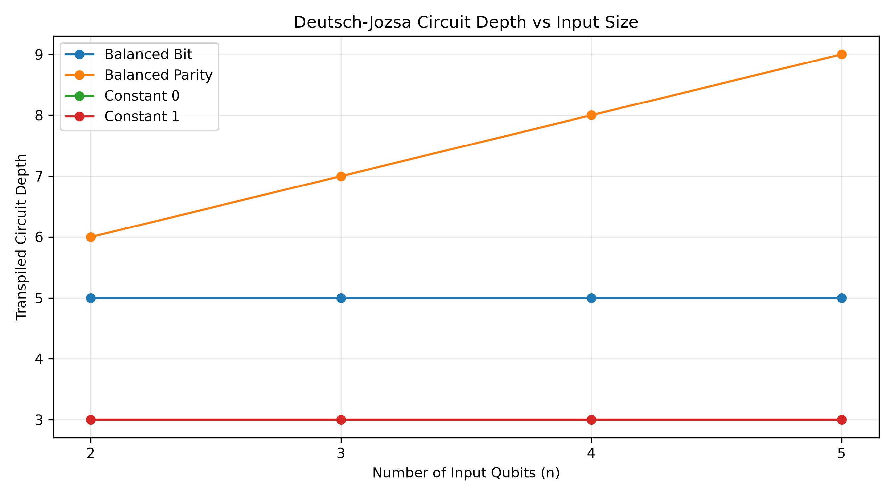
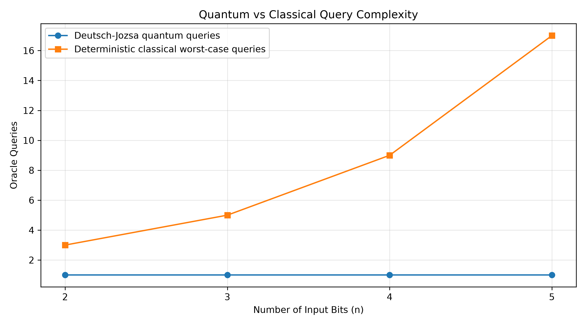

# Transaction Rule Screening Using the Deutsch–Jozsa Algorithm

A simulation-based Quantum Computing IA-3 project demonstrating how the Deutsch–Jozsa algorithm distinguishes **constant** and **balanced** Boolean functions under the algorithm's promise condition.

> **Scope note:** This project is an educational demonstration of the Deutsch–Jozsa promise problem. The transaction-screening theme is illustrative; this code is not a real-world fraud detector and does not evaluate actual customer transactions.

## Project Overview

The project builds and simulates Deutsch–Jozsa circuits for four oracle configurations and input sizes \(n=2,3,4,5\).

- `constant_0`: constant function that always returns 0.
- `constant_1`: constant function that always returns 1.
- `balanced_bit`: balanced function based on one input bit.
- `balanced_parity`: balanced function based on the parity of all input bits.

The implementation uses Python, Qiskit, and Qiskit Aer. It records measurement counts, circuit depth, classification, and validation status in a CSV file. A separate script generates graphs from the recorded results.

## Features

- Creates a Deutsch–Jozsa quantum circuit with `n` input qubits and one ancilla qubit.
- Implements two constant and two balanced oracle examples.
- Simulates each configuration with 1,024 shots.
- Tests input sizes from 2 through 5 qubits.
- Checks the measured classification against the expected category.
- Exports experiment records to `deutsch_jozsa_results.csv`.
- Generates circuit-depth and quantum-versus-classical query comparison plots.

## Repository Structure

```text
Quantum-IA3/
├── deutsch_jozsa.py                  # Circuit construction, simulation, validation and CSV export
├── plot_results.py                   # Generates the report graphs
├── deutsch_jozsa_results.csv         # Recorded results from the simulation
├── circuit_depth_vs_n.png             # Circuit depth versus input size
├── quantum_vs_classical_queries.png   # Quantum and classical query comparison
├── requirements.txt                  # Python package dependencies
├── README.md
├── .gitignore
└── screenshots/                       # Optional genuine VS Code implementation evidence
    ├── 01-project-folder.png
    ├── 02-circuit-and-oracle-code.png
    ├── 03-simulation-and-validation-code.png
    └── 04-results-export-code.png
```

The `screenshots/` directory and filenames above are suggested. Add your own screenshots only if you want to include them in the repository; update the names to match the files you actually save.

## Requirements

- Python 3.12 (the implementation was tested with Python 3.12.10)
- Qiskit (tested with version 2.6.1)
- Qiskit Aer
- pandas
- matplotlib

Use the package versions recorded in your working environment when preparing `requirements.txt`. Do not claim a version was tested unless it matches the environment used to run the project.

### Example `requirements.txt`

```text
qiskit==2.6.1
qiskit-aer
pandas
matplotlib
```

If you have captured the exact installed versions, pin those versions in `requirements.txt` for better reproducibility.

## Setup in Visual Studio Code

### 1. Open the project

Open the `Quantum-IA3` folder in Visual Studio Code, then open **Terminal → New Terminal**.

### 2. Create and activate a virtual environment

**Windows PowerShell:**

```powershell
py -3.12 -m venv .venv
.\.venv\Scripts\Activate.ps1
```

If PowerShell blocks activation because of the execution policy, use the Python executable directly or follow your institution's approved environment setup instructions rather than changing system-wide policy unnecessarily.

### 3. Install dependencies

```powershell
python -m pip install --upgrade pip
pip install -r requirements.txt
```

### 4. Run the Deutsch–Jozsa experiments

```powershell
python deutsch_jozsa.py
```

The script should print a result for each combination of input size and oracle type, followed by a validation summary. The recorded run for this project contained 16 experiments, with 16 passed and 0 failed.

### 5. Generate the graphs

```powershell
python plot_results.py
```

The plotting script should generate:

- `circuit_depth_vs_n.png`
- `quantum_vs_classical_queries.png`

Run the experiment script before the plotting script so the CSV data is up to date.

## Experimental Configuration

| Setting | Value |
|---|---|
| Algorithm | Deutsch–Jozsa |
| Input sizes | \(n=2,3,4,5\) |
| Oracle configurations | `constant_0`, `constant_1`, `balanced_bit`, `balanced_parity` |
| Ancilla qubits | 1 |
| Shots per circuit | 1,024 |
| Backend | Local Qiskit Aer simulator |
| Noise model | None; ideal simulation |
| Number of experiments | 16 |

## Results Summary

The recorded ideal simulation produced the expected classifications for all 16 tested configurations.

| Input size \(n\) | Constant oracle output | Balanced-bit output | Balanced-parity output |
|---:|---|---|---|
| 2 | `00` | `01` | `11` |
| 3 | `000` | `001` | `111` |
| 4 | `0000` | `0001` | `1111` |
| 5 | `00000` | `00001` | `11111` |

Both constant oracle examples produce an all-zero input-register result. The selected balanced examples produce non-zero results. These outcomes are consistent with the Deutsch–Jozsa algorithm when the oracle satisfies the constant-or-balanced promise.

### Query-complexity comparison

For the Deutsch–Jozsa promise problem, the quantum algorithm uses one oracle query. The deterministic classical worst-case query bound used for comparison is:

\[
2^{n-1}+1
\]

For \(n=2,3,4,5\), this gives 3, 5, 9, and 17 queries, respectively. These are **oracle-query counts**, not wall-clock execution times. They do not establish a practical speedup for real transaction-screening systems.

## Graphs

### Circuit depth versus input size



This plot compares the transpiled circuit depths for the selected oracle implementations across the tested input sizes. Depth depends on the oracle structure and the transpilation settings used.

### Quantum versus classical query counts



This plot compares the one-query Deutsch–Jozsa result with the deterministic classical worst-case query bound for the promise problem.

## Screenshots and Implementation Evidence

For a project presentation or report, useful genuine screenshots from Visual Studio Code include:

1. **Project Explorer:** show the Python scripts, CSV results, and generated graphs.
2. **Circuit and oracle implementation:** show the code that creates the registers, prepares the ancilla, applies oracle operations, and measures the input register.
3. **Simulation and validation logic:** show the loop over input sizes and oracle types, simulator execution, and classification checks.
4. **Result export:** show the CSV export and validation-summary code.
5. **Terminal results:** show the actual terminal output with the experiment count and PASS/FAIL summary.
6. **Generated graphs:** open each PNG in VS Code or an image viewer and capture it only if visual evidence is needed.

Save screenshots in the `screenshots/` directory and use captions in your report. Screenshots are supplementary evidence; the `.py` files should remain the authoritative, copyable source code. Do not include API keys, passwords, personal data, or unrelated desktop content in screenshots.

## Limitations

- The experiments use a local ideal simulator, not physical quantum hardware.
- No noise model is applied, so the results do not measure hardware noise or decoherence.
- Only four selected oracle examples are tested for each input size.
- The transaction examples are illustrative; the implementation does not process actual transaction records, train a fraud classifier, or measure fraud-detection precision or recall.
- The query comparison applies only when the Boolean function is promised to be constant or balanced.
- Circuit depth is a simulator/transpilation metric and is not the same as runtime on a quantum device.

## Future Work

- Add automated truth-table checks for every oracle and input size.
- Add unit tests for circuit construction and classification.
- Compare ideal simulation with a clearly documented noise model.
- If access is available and permitted, run a separate experiment on real quantum hardware and report those results separately.
- Develop a classical transaction-rule demonstration using approved synthetic or anonymized data, keeping its outputs distinct from the Deutsch–Jozsa classification.

## Reproducibility

To reproduce the results:

1. Set up Python and install the dependencies.
2. Run `python deutsch_jozsa.py`.
3. Confirm the experiment and validation summary.
4. Run `python plot_results.py`.
5. Inspect the generated CSV and graph files.

The CSV and graph images in the repository should be regenerated from the scripts whenever the implementation or experimental configuration changes.

## Author and Course

- **Project:** Transaction Rule Screening Using the Deutsch–Jozsa Algorithm
- **Course:** Quantum Computing IA-3
- **Course code:** 23CS2037
- **Academic year:** 2026–2027

Add your team details and repository URL here if required by your course submission.
